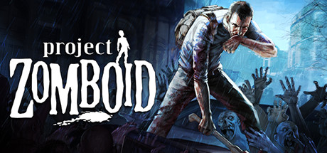

**Project Zomboid by The Indie Stone (Early Access, ongoing since 2013) is the most realistic zombie survival sim ever made.**

---

## 📖 About

Project Zomboid by The Indie Stone (Early Access, ongoing since 2013) is the most realistic zombie survival sim ever made. Set in Knox County, Kentucky, you manage hunger, thirst, boredom, injury, and infection in a world that slowly fills with hundreds of thousands of undead.

## ⚠️ Problems Without Trainer

| Problem | Status |
|---------|--------|
| Infection from scratches kills characters with no in-game cure option | ✅ Solved |
| Boredom and depression stats reduce combat effectiveness unexpectedly | ✅ Solved |
| Noise attracts zed hordes that overwhelm safe houses overnight | ✅ Solved |
| Food spoilage forces constant foraging runs in increasingly cleared areas | ✅ Solved |
| Power and water shutoff timers reset all established base infrastructure | ✅ Solved |

## ✅ Solution

The **Project Zomboid Trainer** solves all these issues, giving you complete control so you can focus on enjoying the game.

## 🎯 Features

- Unlimited Resources / Currency
- God Mode / Invincibility
- Instant Skill & Ability Cooldown
- One-Hit Kill
- Freeze Timers
- Unlock All Items & Achievements
- Custom Speed Multiplier
- Infinite Stamina / Energy

## 🚀 Quick Start

1. **Disable Windows Defender** temporarily (trainer may trigger false positive)
2. Get the trainer from the button above
3. Launch Project Zomboid
4. Run the trainer as Administrator
5. Use the hotkeys to activate cheats in-game

## 💎 Free vs Pro

| Feature | Free | Pro |
|---------|------|-----|
| God Mode | ✅ | ✅ |
| Unlimited Resources | ✅ | ✅ |
| Advanced Cheats | ❌ | ✅ |
| Auto-Updates | ❌ | ✅ |
| Priority Support | ❌ | ✅ |

## 💻 Requirements

- Windows 10 / 11 (64-bit)
- Project Zomboid (any version)
- .NET Framework 4.8+
- DirectX 11+

## 🍎 macOS

## ⚖️ Legal

Educational and single-player use only.

---

